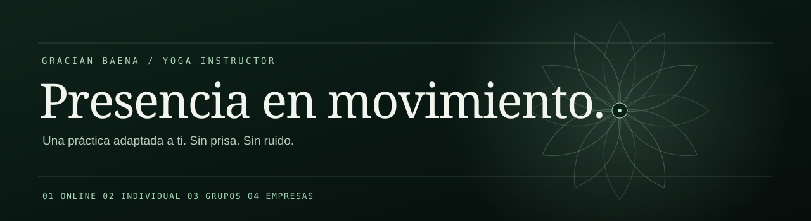

# Yoga Instructor · Gracián Baena

### Presence · Breath · Movement · Teaching

**A thoughtful practice begins by listening to the person in front of you.**

*Murcia, Spain · Online, individual, group and workplace enquiries · Spanish / English / Italian*

[**Explore the Yoga universe ↗**](https://gracianb.github.io/yoga-instructor/) &nbsp;·&nbsp; [**Discover class formats ↗**](https://gracianb.github.io/yoga-instructor/#proyectos) &nbsp;·&nbsp; [**Get in touch ↗**](https://gracianb.github.io/yoga-instructor/#contacto)

---

## Movement with attention

Yoga has been a second professional language for me: an opportunity to work with people through presence, curiosity, clarity and patient instruction.

My approach combines **breath, movement and observation**. Sessions are designed to be understandable and adaptable, with space for different abilities, experience levels and personal objectives. The goal is not a perfect pose or a dramatic performance, but a practice that someone can return to.

[**Enter the interactive instructor portfolio**](https://gracianb.github.io/yoga-instructor/)

## Find your way to practice

| Your starting point | What we can discuss |
| --- | --- |
| **Online classes** | Guided sessions and a structure that works for remote participation. |
| **One-to-one practice** | Individual pacing, alternatives and a conversation about your goals. |
| **Group sessions** | A shared practice with clear guidance and room for different levels. |
| **Workplace wellbeing** | Thoughtful movement and breathing breaks for teams and professional environments. |

[**Explore formats and send an enquiry ↗**](https://gracianb.github.io/yoga-instructor/#contacto)

The contact experience prepares an **editable email**. It does not automatically confirm a reservation, process payment or store enquiry details on a booking server.

## A journey of teaching and learning

The public portfolio documents these chapters:

- **Madrid, 2019:** yoga instructor training.
- **Lisbon, 2020–2021:** workplace wellbeing practice in the Majorel / Google–YouTube operational environment.
- **Murcia, 2022–June 2026:** yoga teaching at Mood Fitness.

Each is presented as part of my professional journey, without inventing attendance totals, client testimonials or medical outcomes.

## What you can explore on the site

The public experience includes an instructor story, class formats, an interactive professional timeline and a gentle optional breathing pause. Visitors can switch between Spanish and English and use light or dark presentation.

The short breathing animation is an **optional visual invitation**, not therapy, a clinical exercise or a substitute for individualized health advice. Sound and timing are user-initiated; the site does not need a visitor account to introduce my work.

### A separate idea in development

Two independent concepts, **Yoga Practice** and **Yoga Asana Book**, are being developed outside the public instructor portfolio. The public site does **not** claim that either application is ready to use. They are **not publicly available**.

The purpose is to keep teaching, self-guided practice and learning resources distinct, with their own scope and accessibility requirements.

## Teaching documents

The current Yoga résumé and cover letter are maintained in my [personal hub](https://github.com/GracianB/GracianB) as the canonical public documents.

| | English | Español |
| --- | --- | --- |
| **Yoga résumé** | [Read PDF](https://gracianb.github.io/GracianB/Gracian_Baena_CV_Yoga_EN.pdf) | [Ver PDF](https://gracianb.github.io/GracianB/Gracian_Baena_CV_Yoga_ES.pdf) |
| **Cover letter** | [Read PDF](https://gracianb.github.io/GracianB/Gracian_Baena_Cover_Letter_Yoga_EN.pdf) | [Ver PDF](https://gracianb.github.io/GracianB/Gracian_Baena_Carta_Yoga_ES.pdf) |

[**View my Yoga application materials ↗**](https://gracianb.github.io/GracianB/apply.html?track=yoga)

## One of three connected universes

Yoga is not a side note to my work with people; it is another way I approach learning, trust and communication. Explore the other two worlds for different expressions of the same curiosity.

[**Professional Deck**](https://gracianb.github.io/professional-deck/) · Customer Success, operations and data  
[**Systems Lab**](https://gracianb.github.io/systems-lab/) · Software, AI and creative experiments

---

**Practice with attention. Teach with care. Keep learning.**

[**Yoga Instructor**](https://gracianb.github.io/yoga-instructor/) · [**Contact**](https://gracianb.github.io/yoga-instructor/#contacto) · [**LinkedIn**](https://www.linkedin.com/in/gracianbaena/)

