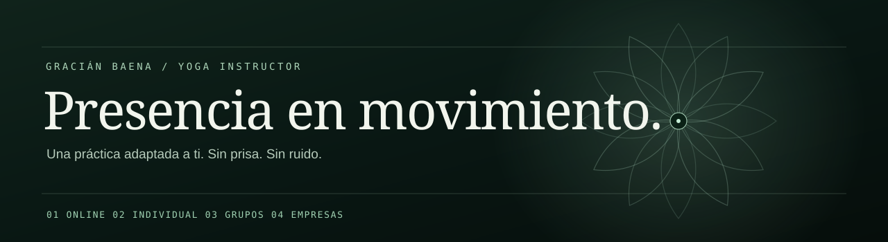

<div align="center">

<a href="https://gracianb.github.io/yoga-instructor/">
  
</a>

# Yoga Instructor · Gracián Baena

**Presencia · Respiración · Movimiento · Enseñanza**

Un espacio personal de yoga: práctica adaptable, experiencia docente y una forma de contacto clara.

[**Explorar el portfolio ↗**](https://gracianb.github.io/yoga-instructor/) · [**Modalidades ↗**](https://gracianb.github.io/yoga-instructor/#proyectos) · [**Contacto ↗**](https://gracianb.github.io/yoga-instructor/#contacto)

</div>

---

## Versión pública · V2.2 Evergreen

La interfaz actual utiliza una **retícula editorial compartida de 1120 px**, módulos proporcionados y un formulario centrado en una sola columna. En móvil, las opciones se reorganizan para evitar desbordamiento.

**Paleta:** bosque, salvia y eucalipto. Modo claro vegetal y modo oscuro bosque profundo; superficies, botones, elementos interactivos y texto comparten los mismos colores. Sin efectos de zoom obligatorios y con respeto por movimiento reducido.

**Estado verificado (20 oct. 2026, commit `0e6eac6`):** [Yoga Quality SUCCESS ↗](https://github.com/GracianB/yoga-instructor/actions/runs/39425361047) · [Yoga Deploy SUCCESS ↗](https://github.com/GracianB/yoga-instructor/actions/runs/39429219945).

La validación contempla las anchuras 1440, 1100, 800, 390 y 320 px, tema claro/oscuro, ausencia de desbordamiento horizontal, contraste, controles activos y pruebas del navegador. CI correcto no sustituye una auditoría visual individual de todos los dispositivos.

## Clases y experiencia

| Modalidad | Propuesta |
| --- | --- |
| [Yoga online ↗](https://gracianb.github.io/yoga-instructor/#contacto) | Sesiones en directo con respiración, movimiento y acompañamiento |
| [Sesiones individuales ↗](https://gracianb.github.io/yoga-instructor/#contacto) | Práctica 1:1 adaptable a objetivos y ritmos |
| [Grupos ↗](https://gracianb.github.io/yoga-instructor/#contacto) | Clases multinivel y opciones accesibles |
| [Empresas ↗](https://gracianb.github.io/yoga-instructor/#contacto) | Sesiones y pausas corporativas de bienestar |

**Trayectoria documentada:** formación como instructor de yoga en Madrid (2019), bienestar corporativo en el entorno de Majorel/Google-YouTube en Lisboa (2020–2021) y docencia en Mood Fitness, Murcia (2022–junio de 2026).

El recorrido profesional público contiene **tres etapas seleccionables** con información contextual y navegación por teclado; sus conectores son narrativos, no un mapa geográfico.

## Una pausa optativa

La sección de clases presenta una pausa visual de **30 segundos**, con tres ciclos orientativos de inhalación de 4 s y exhalación de 6 s. Música y temporizador requieren activación voluntaria. No hay autoplay ni indicaciones médicas.

El [formulario de contacto ↗](https://gracianb.github.io/yoga-instructor/#contacto) recopila modalidad y necesidades para **preparar un correo editable**, que la persona decide si envía. No promete una reserva ni almacena las respuestas en un backend.

## Dos aplicaciones independientes · en desarrollo

**Yoga Practice** y **Yoga Asana Book** están **en desarrollo y no disponibles** públicamente: no forman parte de la web pública V2.2.

La [PR #213 · Apps V1.4 ↗](https://github.com/GracianB/yoga-instructor/pull/213) reúne dos aplicaciones separadas que comparten un motor visual y módulos comunes:

- **Yoga Practice:** secuencia fija Montaña (75 s) → Flexión suave (75 s) → Niño (90 s), cinco patrones de respiración y meditación silenciosa o guiada voluntaria.
- **Yoga Asana Book:** diez posturas con filtros, instrucciones, alternativas, enlaces directos y una figura SVG compartida.
- **Calidad independiente:** [Node y E2E Chromium, Firefox y WebKit aprobados en `cffd2552` ↗](https://github.com/GracianB/yoga-instructor/actions/runs/39316868550).

**Decisión de publicación:** mantener la PR #213 en borrador y sin fusionar mientras se prepara la entrega independiente. Sus pruebas verdes demuestran la validación técnica de esa rama; **no significan que las apps estén publicadas ni terminadas en la experiencia final**. Antes de publicarlas hace falta acordar destino, revisar contenido y accesibilidad final, comprobar enlaces y separar cualquier dependencia del portfolio. Evitar mostrar botones públicos que aparenten lanzar aplicaciones todavía privadas o en desarrollo.

## Documentación canónica

Los CV y cartas públicas vigentes se centralizan en el hub:

| Documento | Español | English |
| --- | --- | --- |
| CV Yoga | [PDF ↗](https://gracianb.github.io/GracianB/Gracian_Baena_CV_Yoga_ES.pdf) | [PDF ↗](https://gracianb.github.io/GracianB/Gracian_Baena_CV_Yoga_EN.pdf) |
| Carta Yoga | [PDF ↗](https://gracianb.github.io/GracianB/Gracian_Baena_Carta_Yoga_ES.pdf) | [PDF ↗](https://gracianb.github.io/GracianB/Gracian_Baena_Cover_Letter_Yoga_EN.pdf) |

[**Candidaturas y documentos ↗**](https://gracianb.github.io/GracianB/apply.html?track=yoga)

## Diseño, tecnología y calidad

| Capa | Implementación |
| --- | --- |
| Sitio | HTML, CSS y JavaScript; ES/EN; tema claro y oscuro |
| Arte | Loto SVG original, ambiente botánico y recorrido docente interactivo |
| Pausa y música | Temporizador optativo, reproducción explícita y movimiento reducido |
| Contacto | Generación local de correo, sin backend de formularios |
| Calidad | Node 24, contratos, Playwright Chromium/Firefox/WebKit |
| Publicación | GitHub Actions → GitHub Pages; apps fuera de `main` |

```bash
npm ci
npm run quality
npm run build
npm run test:browser
```

**Ecosistema:** [GracianB](https://gracianb.github.io/GracianB/) · [Professional Deck](https://gracianb.github.io/professional-deck/) · [Systems Lab](https://gracianb.github.io/systems-lab/).

<sub>Yoga Instructor · V2.2 Evergreen · 20 de octubre de 2026. Sin promesas médicas, reproducción automática ni atribución de funcionalidades no publicadas.</sub>
